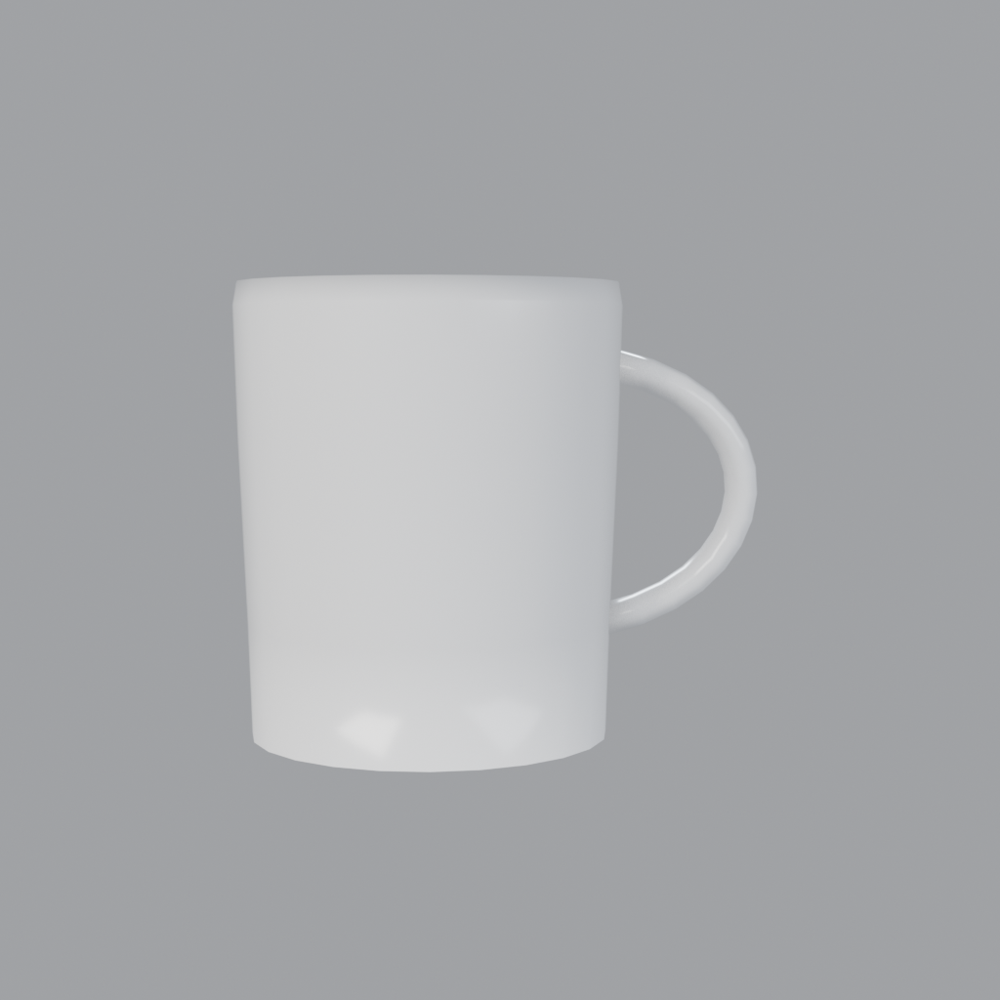
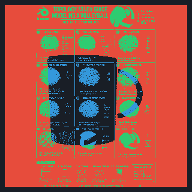

# Blender Headless AI Coding Agent (Universal Multi-Genre Suite)

ชุดเครื่องมือและสถาปัตยกรรมอัตโนมัติสำหรับการรัน **Blender แบบ Headless (Background Mode)** ควบคุมผ่าน Command Line และ Python BPY Script ออกแบบมาสำหรับ AI Coding Agent ตามมาตรฐาน **Capybala BPY & pstack Architecture**

---

## 🖼️ ภาพตัวอย่างผลงานเรนเดอร์จริง (Visual Showcase)

| ☕ Reconstructed Coffee Mug (Image-to-3D) |

|  |

| **860 Tris** · Pure Quad Lathe · Ceramic & Liquid Shader |

### 🔍 Stage C: Closed-Loop Blueprint Verification & Silhouette Overlay

> *การวิเคราะห์เปรียบเทียบความเที่ยงตรงของโครงร่าง (Silhouette Alignment): ภาพต้นฉบับ ➔ ภาพเรนเดอร์ 3D ➔ แมปการเหลื่อมทับ (สีเขียว = ส่วนที่ตรงกัน, สีแดง = ชิ้นส่วน 3D ที่ยื่นเกิน, สีน้ำเงิน = ส่วนที่ขาดหาย)*

---

## 🚀 คุณสมบัติเด่น (Key Features)

- **Pure Headless Execution**: รันสคริปต์ 3D เบื้องหลัง 100% โดยไม่ต้องเปิดหน้าต่าง GUI
- **Universal Multi-Genre Profiles (`profiles/*.json`)**:
  - `lowpoly_prop.json`: ไอเทมเกมขนาดเล็ก พืช ก้อนหิน (Max 500 Tris, Pivot Grounded)
  - `character.json`: ตัวละคร มาสคอต สิ่งมีชีวิตโมดูลาร์ (Max 4,500 Tris, Toon/Cel)
  - `hard_surface.json`: อุปกรณ์อิเล็กทรอนิกส์ ชิ้นส่วนกลไก ยานพาหนะ (Max 8,000 Tris, Metallic PBR)
  - `environment_kit.json`: ชุดฉาก สถาปัตยกรรม และบ่อน้ำ (Max 3,500 Tris)
- **Procedural Shader Generator (`src/shader_generator.py`)**:
  - สร้าง Principled BSDF procedural materials ที่เข้ากันได้กับ glTF 2.0 / Godot 4.x
  - ด่านตรวจจับโหนด EEVEE/Volumetric ที่ไม่รองรับในเกมเอนจิน (`audit_material_nodes`)
- **Comprehensive 4-Tier QA Hard Gates (`src/quality_checker.py`)**:
  1. `audit_polycount()`: ตรวจสอบงบประมาณ Triangles เทียบกับ Profile ป้องกันโมเดลโพลีกอนบวม
  2. `audit_transforms()`: ตรวจสอบ Unapplied Scale และการแนบสนิทระนาบพื้นฐานล่าง $Z = 0$
  3. `audit_mesh_topology()`: ตรวจจับ Non-manifold edges และ Loose vertices/edges
  4. `audit_interpenetration()`: ตรวจจับการชนกันของ Mesh ด้วย AABB Fast-Path และ BVHTree
  5. `audit_floating()` & `audit_attachment_contact()`: ตรวจจับวัตถุลอยในสุญญากาศ หรือช่องว่างผิวสัมผัสชิ้นส่วนติดผนัง/ข้อต่อ
  6. `audit_spacing()`: ตรวจจับระยะห่างในแถวหรืออาเรย์ที่ตำแหน่งคลาดเคลื่อน (Pattern & Array Drift)
  7. `audit_exposure()`: ตรวจวัดค่าความสว่างเฉลี่ย (Mean/Median Luma), Specular Clipping, และ Crushed Blacks
  8. `audit_glb_export()`: ตรวจสอบการส่งออกไฟล์ `.glb` จริงในโหมด Headless
- **Measurement-Driven Image-to-3D Pipeline (`src/image_reconstructor.py` & `src/blueprint_verifier.py`)**:
  - ถอดโครงสร้างภาพอ้างอิง 2D เป็นโจทย์การวัด (Calibration, Silhouette Extraction, Aspect Ratio, Half-Profile Lathe Radii)
  - สร้างเรขาคณิตด้วย Procedural BMesh (Pure Quads, Wall Thickness, Recessed Base, Swept Bezier Curved Handles)
  - ตรวจสอบความเที่ยงตรงด้วย **Silhouette IoU (Intersection-over-Union)** และผลิตภาพวิเคราะห์ Blueprint Overlay อัตโนมัติ
- **Complete 4-in-1 Deliverables**: ผลิต `.blend` + `.glb` + ภาพเรนเดอร์ + `qa_report.json` + `components.json` พร้อมบันทึกทักษะลงใน `.agents/skills/` อัตโนมัติ

---

## 🛠️ โครงสร้างโปรเจกต์ (Project Structure)

```text
Blender_Headless-AI-Coding-Agent/
├── docs/
│   └── images/                 # ภาพตัวอย่างผลงานเรนเดอร์และ Blueprint Verification Overlay
├── profiles/
│   ├── lowpoly_prop.json       # โปรไฟล์สำหรับพร็อพเกมขนาดเล็ก
│   ├── character.json          # โปรไฟล์สำหรับตัวละครและมาสคอต
│   ├── hard_surface.json       # โปรไฟล์สำหรับชิ้นส่วนกลไกและฮาร์ดแวร์
│   └── environment_kit.json    # โปรไฟล์สำหรับชุดฉากและสถาปัตยกรรม
├── scripts/
│   ├── find_blender.ps1        # สคริปต์ค้นหาพาธ blender.exe อัตโนมัติ 6 ระดับ
│   ├── run_headless.ps1        # สคริปต์รันคำสั่ง Headless CLI มาตรฐาน
│   ├── template_worker.py      # ตัวอย่าง BPY Worker สคริปต์แบบ Profile-driven
│   ├── build_mech_robot.py     # ตัวอย่างการสร้าง Mech Robot พร้อม Armature Rigging
│   └── build_from_reference.py # สคริปต์สร้างโมเดลจากภาพอ้างอิงและวัดผล IoU
├── src/
│   ├── profile_loader.py       # ระบบโหลดและรวมค่า Profile มาตรฐาน
│   ├── shader_generator.py     # ตัวช่วยสร้างโหนด Shader และตรวจสอบ glTF Safety
│   ├── quality_checker.py      # โมดูลตรวจวัดคุณภาพ 4 ด่าน (Geometry, Transform, Exposure, Export)
│   ├── image_reconstructor.py  # ระบบวัดขนาดและสร้างเรขาคณิต 3D จากภาพ 2D
│   └── blueprint_verifier.py   # ระบบตรวจวัดความเที่ยงตรง Silhouette IoU และ Blueprint Overlay
├── tests/
│   ├── test_headless_smoke.py  # ชุดทดสอบ Unit & Smoke Test (17 checks)
│   └── test_image_reconstruction.py # ชุดทดสอบ Silhouette & IoU Verification (5 checks)
├── .gitignore
└── README.md
```

---

## 💻 การใช้งานเบื้องต้น (Quick Start)

### 1. ตรวจสอบความพร้อมของ Blender (Preflight Check)
```powershell
powershell -ExecutionPolicy Bypass -File scripts/run_headless.ps1 --probe
```

### 2. รันสคริปต์สร้างโมเดลตามโปรไฟล์ที่ต้องการ
```powershell
# รันงาน Hard-surface
powershell -ExecutionPolicy Bypass -File scripts/run_headless.ps1 -Script scripts/template_worker.py -ScriptArgs "--profile hard_surface --out-dir outputs/drone"

# รันงาน Low-poly Props สำหรับเกม
powershell -ExecutionPolicy Bypass -File scripts/run_headless.ps1 -Script scripts/template_worker.py -ScriptArgs "--profile lowpoly_prop --out-dir outputs/rock_pack"
```

### 3. รันการแปลงภาพอ้างอิงเป็นโมเดล 3D (Image-to-3D Measurement & Reconstruction)
```powershell
powershell -ExecutionPolicy Bypass -File scripts/run_headless.ps1 `
    -Script scripts/build_from_reference.py `
    -OutDir outputs/coffee_mug `
    -ScriptArgs @("--image", "outputs/Blender/Img/ref/Coffee Mug/777851637_900653342693059_575899448985784479_n.jpg")
```

### 4. รันชุดทดสอบคุณภาพ (Smoke & Unit Tests - 22 Checks)
```powershell
python -m unittest discover -s tests
```

---

## 📜 มาตรฐานค่าความสว่างแสง (Calibrated Exposure Bands)
- **สตูดิโอ (Studio)**: Mean Luma `100 – 170`, Max Clipping `<= 1.5%`, Max Dark `<= 35.0%`
- **กลางแจ้งแสงสีทอง (Outdoor Golden)**: Mean Luma `95 – 175`, Max Clipping `<= 2.0%`, Max Dark `<= 30.0%`
- **กลางคืน (Night)**: Mean Luma `15 – 70`, Max Clipping `<= 2.5%`, Max Dark `<= 55.0%`, `|Mean - Median| <= 18.0`
- **อวกาศ (Space)**: Mean Luma `5 – 60`, Max Clipping `<= 1.5%`, Max Dark `<= 92.0%`
